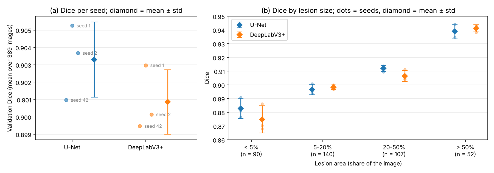
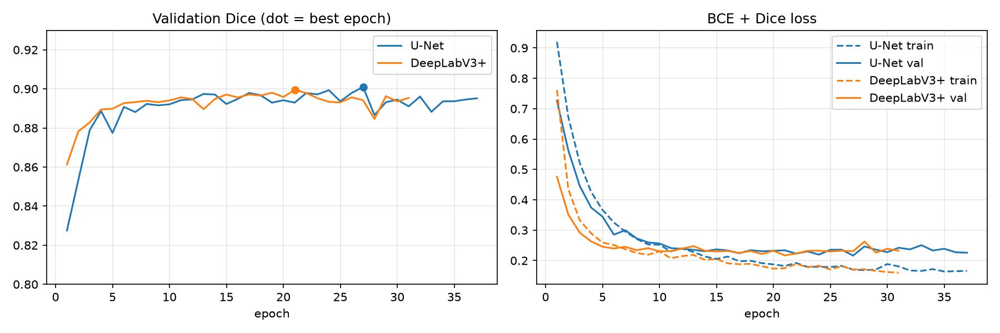
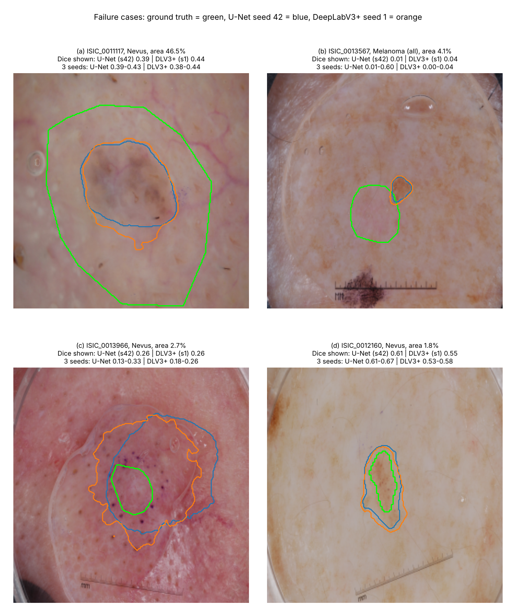
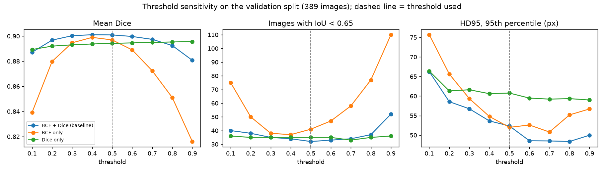
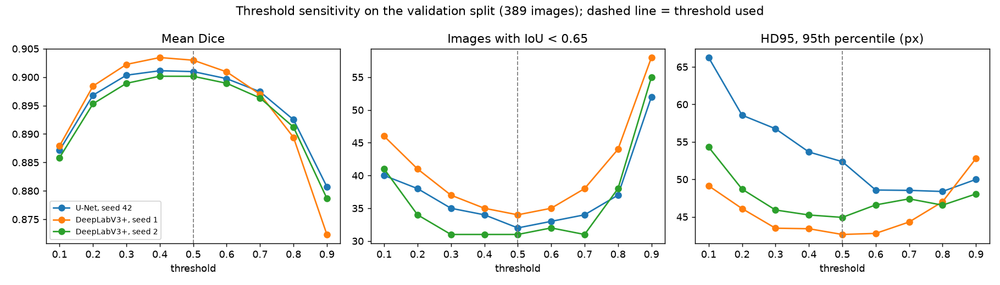

<div align="center">

# Skin lesion segmentation on ISIC 2018

**U-Net vs DeepLabV3+ with the same ResNet-34 encoder: does the decoder matter?**

Computer Vision 2026 · Innopolis University


-555555?logo=apple)

</div>

---

## Contents

- [Overview](#overview)
- [Key results](#key-results)
- [Failure cases](#failure-cases)
- [Ablation](#ablation)
- [Live demo](#live-demo)
- [Setup](#setup)
- [Data](#data)
- [Train and evaluate](#train-and-evaluate)
- [Reproduce the tables and figures](#reproduce-the-tables-and-figures)
- [Repository structure](#repository-structure)
- [Limitations](#limitations)
- [Team contributions](#team-contributions)

## Overview

**Task.** Binary segmentation of the skin lesion in a dermoscopic image: for every pixel, decide whether it
belongs to the lesion. The data come from the [ISIC 2018 Challenge, Task 1](https://challenge.isic-archive.com/landing/2018/45/).

**Research question.** With the encoder, data, augmentations, loss and training schedule fixed, does
replacing the U-Net decoder with DeepLabV3+ (atrous spatial pyramid pooling, more global context)
improve segmentation quality and boundary accuracy, and at what runtime cost?

| | |
|---|---|
| **Baseline** | U-Net, ResNet-34 encoder (ImageNet), 24.4 M parameters |
| **Second condition** | DeepLabV3+, same ResNet-34 encoder, 22.4 M parameters (only the decoder changes) |
| **Data** | 2,594 official training images, split 85/15 into 2,205 train / 389 validation, leakage-aware |
| **Input** | 256 × 256, ImageNet normalisation |
| **Augmentations** (train only) | flips, 90° rotations, affine (scale 0.9–1.1, shift ±6%, rotate ±30°), colour jitter |
| **Training** | BCE + Dice loss, AdamW (lr 1e-4, wd 1e-4), batch 16, ≤ 50 epochs, early stopping on val Dice (patience 10) |
| **Seeds** | 3 per model (1, 2, 42) |
| **Metrics** | Dice, IoU, ISIC thresholded Jaccard, HD95 (pixels), training time, inference time per image |

**Leakage-free split.** Images of the same patient or lesion (ISIC metadata), and near-duplicate photos of
the same lesion (SIFT keypoints + RANSAC, ≥ 8 inliers; 134 pairs found), are merged into groups with
union-find. Whole groups go to either train or val, so no lesion appears on both sides. The largest
train–val SIFT match after the split is 7 inliers (below the duplicate threshold). The exact split is
committed in [`splits/`](splits/).

## Key results

Validation split, 389 images, 256 × 256, **mean ± std over 3 seeds** (sample std, ddof = 1).

| Metric | U-Net | DeepLabV3+ |
|---|:---:|:---:|
| Dice ↑ | **0.903 ± 0.002** | 0.901 ± 0.002 |
| IoU ↑ | **0.837 ± 0.003** | 0.834 ± 0.003 |
| ISIC thresholded Jaccard ↑ | **0.797 ± 0.002** | 0.793 ± 0.005 |
| Images with IoU < 0.65 ↓ | **32.3 ± 0.6** | 33.3 ± 2.1 |
| HD95 median, px ↓ | 7.14 ± 0.12 | **6.87 ± 0.48** |
| HD95 95th percentile, px ↓ | 47.5 ± 4.2 | **43.1 ± 1.7** |
| Training time per run, min (M4) | 53.6 ± 12.4 | 47.7 ± 2.4 |
| Inference, ms / image (M3, batch 1) | **10.5** | 17.0 |
| Parameters, M | 24.4 | **22.4** |

<p align="center">
  
</p>

**What it means.**

- **Region overlap is the same.** The Dice gap (−0.002 for DeepLabV3+) is about the size of the spread
  between seeds. On per-image Dice averaged over seeds the 95% bootstrap CI of the difference is
  [−0.006, +0.001].
- **DeepLabV3+ makes smaller worst-case boundary errors.** Its 95th percentile of HD95 is lower by 4.4 px
  (in two of three seeds), but it does not fail on fewer images.
- **U-Net is better on small lesions.** For lesions under 5% of the image, Dice is 0.883 vs 0.875.
  DeepLabV3+ predicts at 1/4 resolution and has a single skip connection, so fine borders are blurred.
- **U-Net is ~1.6× faster at inference** (10.5 vs 17.0 ms per image on the same machine).

Full tables (per seed, by lesion size, by diagnosis, paired tests): [`results/comparison/seeds_summary.md`](results/comparison/seeds_summary.md).
Single-seed (42) comparison with timings: [`results/comparison/comparison.md`](results/comparison/comparison.md).

<details>
<summary><b>Dice by lesion size and by diagnosis</b> (mean ± std over seeds)</summary>

| Lesion area | n | U-Net | DeepLabV3+ | Δ |
|---|:---:|:---:|:---:|:---:|
| < 5% | 90 | 0.883 ± 0.007 | 0.875 ± 0.010 | −0.008 |
| 5–20% | 140 | 0.897 ± 0.004 | 0.898 ± 0.002 | +0.002 |
| 20–50% | 107 | 0.912 ± 0.002 | 0.906 ± 0.004 | −0.006 |
| > 50% | 52 | 0.939 ± 0.005 | 0.941 ± 0.003 | +0.002 |

| Diagnosis | n | U-Net | DeepLabV3+ | Δ |
|---|:---:|:---:|:---:|:---:|
| Melanoma (all) | 88 | 0.891 ± 0.005 | 0.883 ± 0.001 | −0.007 |
| Nevus | 263 | 0.915 ± 0.001 | 0.913 ± 0.003 | −0.002 |
| Seborrheic keratosis | 38 | 0.850 ± 0.020 | 0.856 ± 0.007 | +0.006 |

</details>

<details>
<summary><b>Learning curves</b> (seed 42)</summary>

<p align="center"></p>

</details>

## Failure cases

An image counts as a failure if IoU < 0.65 (the ISIC threshold). 13 validation images fail in **all six
runs**; we show four of them with different causes, so each is a property of the image and not of one
training run. Green = ground truth, blue = U-Net, orange = DeepLabV3+.

<p align="center"></p>

| Case | Image | Likely cause |
|---|---|---|
| (a) | ISIC_0011117, nevus | The annotation includes a pale halo around the pigment; the models follow the visible border |
| (b) | ISIC_0013567, melanoma in situ | Faint, almost unpigmented lesion; the models segment a darker spot next to it |
| (c) | ISIC_0013966, nevus | The edge of an immersion-fluid fold is the strongest contour and is taken as the lesion border |
| (d) | ISIC_0012160, nevus | Small (1.8%) light lesion with a diffuse border; DeepLabV3+ is worse in every seed |

Full analysis with per-seed Dice: [`results/failures/failure_analysis.md`](results/failures/failure_analysis.md).

## Ablation

Two experiments on the validation split (389 images). Details and all tables:
[`results/ablation/README.md`](results/ablation/README.md).

### 1. Loss function (U-Net, seed 42, retrained)

Only the loss changes; data, split, augmentations, optimiser, early stopping and seed are the same.

| Loss | Dice ↑ | IoU ↑ | ISIC thr. Jaccard ↑ | IoU < 0.65 ↓ | HD95 p95, px ↓ | Best / run epochs |
|---|:---:|:---:|:---:|:---:|:---:|:---:|
| **BCE + Dice** (used) | **0.901** | **0.834** | **0.796** | **32** | 52.4 | 27 / 37 |
| BCE only | 0.897 | 0.828 | 0.778 | 41 | **52.0** | 18 / 28 |
| Dice only | 0.894 | 0.825 | 0.787 | 35 | 60.8 | 10 / 20 |

<p align="center"></p>

- **The combined loss is best on every overlap metric.** Dropping a term costs 0.004 (BCE only) or 0.007
  (Dice only) Dice, 2–3× the seed std of the baseline. The paired 95% bootstrap CIs still include zero
  and each variant has one seed, so this is a trend, not a significant result.
- **BCE only** gives soft, poorly calibrated probabilities: Dice depends strongly on the threshold
  (spread 0.027 over 0.3–0.7), and at 0.5 it under-segments, with 9 more failed images.
- **Dice only** gives almost binary outputs but stops early (best epoch 10) and has the worst boundary
  outliers (HD95 p95 60.8 px).

### 2. Threshold sensitivity (final models, no retraining)

U-Net seed 42 and DeepLabV3+ seeds 1 and 2, threshold swept from 0.1 to 0.9.

<p align="center"></p>

- **The fixed threshold 0.5 is practically optimal.** The best threshold is 0.4 for all three runs and
  gains at most +0.0004 Dice. The threshold was not tuned on validation, so the results are not
  optimistically biased.
- Over 0.3–0.7, Dice changes by at most 0.006, and the models stay within 0.004 Dice of each other, so
  the "practically equal" conclusion does not depend on the threshold. Only the extremes hurt (0.1 or 0.9:
  −0.012 to −0.031 Dice, 40–58 failed images instead of 31–34).

```bash
python train.py    --config configs/ablation/unet_r34_bce_only.yaml     # ~36 min on MPS
python evaluate.py --config configs/ablation/unet_r34_bce_only.yaml
python train.py    --config configs/ablation/unet_r34_dice_only.yaml    # ~27 min on MPS
python evaluate.py --config configs/ablation/unet_r34_dice_only.yaml
python scripts/summarize_loss_ablation.py                               # loss table + curves
python scripts/threshold_sensitivity.py                                 # threshold sweep of the final models
```

## Live demo

A local web app that runs both trained models side by side. It works offline: the server needs only the
packages from `requirements.txt`, and the page loads nothing from the internet.

```bash
source .venv/bin/activate
python demo/app.py                                          # opens http://127.0.0.1:7860
python demo/app.py --device cpu --port 8000 --no-browser    # other options
```

The app reads the checkpoints from `checkpoints/` (paths as in `configs/*.yaml`, e.g.
`checkpoints/unet_r34_best.pt`). Checkpoints are not in git: train the models or copy the `*_best.pt`
files there. Seeds without a checkpoint are simply not offered.

**What it shows**

- **13 validation images** (never seen in training) in four groups: typical cases, cases where U-Net wins
  in every seed, cases where DeepLabV3+ wins in every seed, and the four failure cases. You can also
  upload your own image (no ground truth, so no metrics).
- **Views:** overlay, contours, probability map, and an error map against the ground truth
  (correct / extra / missed pixels).
- **Threshold slider:** masks redraw instantly, Dice / IoU / HD95 are recomputed.
- **Seed selector** per model, inference time, agreement between the models, and the Dice of the same
  image in all six runs.
- **Results** and **How it works** tabs: the final tables, ablation results and figures.

The pipeline is the same as in `evaluate.py` (resize to 256 × 256, ImageNet normalisation, sigmoid,
threshold 0.5), so for the example images the live Dice equals `results/*/per_image_val.csv`.
The 2-minute demo script is in [`demo/README.md`](demo/README.md).

## Setup

Tested on a **MacBook Air (Apple M4, 24 GB, macOS 26.6)**, **Python 3.14.3** (Homebrew), PyTorch with the
MPS backend. All dependencies are pinned in [`requirements.txt`](requirements.txt).

```bash
git clone https://github.com/amiranabiullina/skin_lesions_CV_project.git
cd skin_lesions_CV_project
python3 -m venv .venv
source .venv/bin/activate          # Windows: .venv\Scripts\activate
pip install -r requirements.txt
```

| Package | Version | Package | Version |
|---|---|---|---|
| torch | 2.14.1 | albumentations | 2.0.8 |
| torchvision | 0.29.1 | opencv-python-headless | 5.0.0.93 |
| segmentation_models_pytorch | 0.5.0 | numpy / scipy | 2.4.6 / 1.17.1 |
| timm | 1.0.30 | pandas | 3.0.6 |
| matplotlib | 3.11.2 | ImageHash, Pillow, PyYAML, requests, tqdm | see file |

**Other hardware.** The configs use `device: mps`. On an NVIDIA GPU set `device: cuda` in the config;
if the requested device is not available the code falls back to the CPU (training on CPU is slow).

## Data

Only the official **training** set (2,594 images with masks) is used for training and validation.
The official 1,000-image test set is kept aside and was not used for any decision.

```bash
# 1. Download the official zips into data/raw/ (resumable; checked with Content-Length and CRC)
python scripts/download_data.py
#    or put ISIC2018_Task1-2_Training_Input.zip and ISIC2018_Task1_Training_GroundTruth.zip
#    into data/raw/ or ~/Downloads. If the browser already unzipped them:
python scripts/verify_extracted.py ~/Downloads/ISIC2018_Task1-2_Training_Input

# 2. Verify, run the EDA and cache 256x256 images/masks in data/processed/
python scripts/prepare_data.py

# 3. Optional: rebuild the metadata and the split (both are already committed in splits/)
python scripts/fetch_metadata.py
python scripts/make_split.py
```

Dataset facts (from [`results/eda_train.json`](results/eda_train.json)): 206 distinct image sizes
(width 576–6748 px, height 540–4499 px); the lesion covers 0.3%–98.7% of the image (median 13.8%); 624 images have a
lesion under 5% of the area; no empty masks.

## Train and evaluate

Every run is fully described by one YAML file in [`configs/`](configs/):

| Config | Model | Seed |
|---|---|:---:|
| `unet_r34.yaml` | U-Net | 42 |
| `unet_r34_seed1.yaml`, `unet_r34_seed2.yaml` | U-Net | 1, 2 |
| `deeplabv3plus_r34.yaml` | DeepLabV3+ | 42 |
| `deeplabv3plus_r34_seed1.yaml`, `deeplabv3plus_r34_seed2.yaml` | DeepLabV3+ | 1, 2 |

```bash
# Sanity checks
python scripts/check_augmentations.py                              # image/mask alignment after augmentation
python train.py --config configs/unet_r34.yaml --overfit-batch     # the model must overfit one batch

# Train (best checkpoint by val Dice -> checkpoints/, log -> results/.../train_log.csv)
python train.py --config configs/unet_r34.yaml
python train.py --config configs/deeplabv3plus_r34.yaml

# Evaluate on the validation split -> metrics_val.json, per_image_val.csv, figures/
python evaluate.py --config configs/unet_r34.yaml
python evaluate.py --config configs/deeplabv3plus_r34.yaml
```

Repeat with the `_seed1` / `_seed2` configs for the other seeds. Checkpoints are not stored in git
(`*.pt` is ignored).

**Runtime.** One training run takes 40–65 min on the M4 (27–43 epochs with early stopping).
On one machine (Apple M3, [`speed_benchmark.json`](results/comparison/speed_benchmark.json)) an epoch takes
70 s for U-Net and 94 s for DeepLabV3+; inference is 10.5 and 17.0 ms per image.

## Reproduce the tables and figures

These need only the committed results, not the data or the checkpoints, unless stated otherwise:

```bash
python scripts/aggregate_seeds.py    # 3-seed table + seeds_dice.png      -> results/comparison/seeds_summary.*
python compare.py                    # seed-42 paired comparison          -> results/comparison/comparison.*  (needs data + checkpoints)
python scripts/benchmark_speed.py    # same-machine speed of both models  -> results/comparison/speed_benchmark.json (needs data)
python scripts/plot_failures.py      # failure-case figure                -> results/failures/failure_cases.png (needs data + checkpoints)
```

## Repository structure

```
├── configs/                    one YAML per run (model, seed, training, output paths)
│   └── ablation/               BCE-only and Dice-only U-Net configs
├── src/
│   ├── dataset.py              Dataset class and augmentations (albumentations)
│   ├── model.py                U-Net / DeepLabV3+ builder (segmentation_models_pytorch)
│   ├── losses.py               BCE + Dice loss
│   ├── metrics.py              Dice, IoU, HD95 (per image)
│   └── utils.py                config, seeding, device selection
├── scripts/
│   ├── download_data.py        resumable download of the official ISIC 2018 zips
│   ├── verify_extracted.py     check an unzipped folder against the official CRC32s
│   ├── prepare_data.py         verification, EDA, 256x256 cache
│   ├── fetch_metadata.py       lesion_id / patient_id from the ISIC archive API
│   ├── make_split.py           leakage-aware 85/15 split (metadata + SIFT duplicates)
│   ├── check_augmentations.py  augmentation sanity check and figure
│   ├── benchmark_speed.py      training/inference speed of both models on one machine
│   ├── aggregate_seeds.py      mean ± std over seeds, final table and figure
│   ├── plot_failures.py        failure-case figure
│   ├── threshold_sensitivity.py   threshold sweep 0.1–0.9 (ablation)
│   └── summarize_loss_ablation.py loss ablation table and curves
├── train.py                    training with early stopping
├── evaluate.py                 validation metrics, timings, figures
├── compare.py                  paired U-Net vs DeepLabV3+ comparison
├── demo/                       local web demo (app.py, static page, 13 example images)
├── splits/                     the exact train/val split, metadata, near-duplicate pairs
├── results/                    metrics, per-image CSVs, logs and figures of every run
│   ├── comparison/             model comparison and 3-seed summary
│   ├── failures/               failure analysis
│   └── ablation/               loss ablation and threshold sensitivity
├── reports/                    milestone reports (LaTeX / Markdown)
└── requirements.txt
```

`data/` and `checkpoints/` are created locally and are not tracked.

## Limitations

- All numbers are on our 389-image validation split; the official ISIC 2018 test set was not evaluated.
- One resolution (256 × 256): HD95 is in pixels at this size, and small lesions lose detail.
- Three seeds per model give a rough estimate of the spread; the Dice difference between models is within it.
- The causes of the failure cases are read from the images and were not tested experimentally.
- Annotations are inconsistent (some are coarse polygons, some follow the border closely), which caps the
  achievable overlap.

## Team contributions

| Member | Contribution |
|---|---|
| **Ilmira Usmanova** | Evaluation script (Dice, IoU, HD95), result tables and figures |
| **Ilia Kulichenko** | Training script and U-Net baseline experiments |
| **Alsu Nizamieva** | DeepLabV3+ experiments and runtime measurements |
| **Amira Nabiullina** | Dataset code, preprocessing and splits; ablation; coordination; README and final summary |
| **Andrei Silantev** | Boundary and failure-case analysis |
